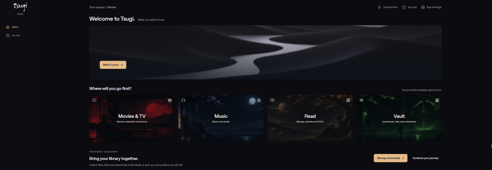
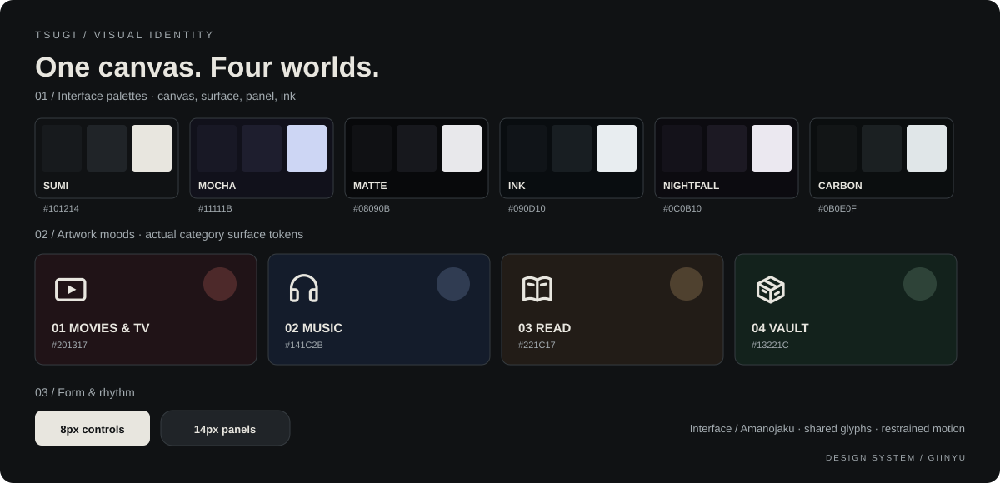

  

# TSUGI — Stremio desktop client, manga reader, music player & download manager

**One home. Many worlds.** An open-source, portable Windows x64 media center that brings **Stremio and Nuvio addons, Mihon-compatible manga extensions, YouTube Music, SoundCloud, Eclipse music addons and aria2 downloads** into one native desktop workspace.

  <a href="https://github.com/G1NYU/TSUGI/releases"><strong>Download for Windows</strong></a> &nbsp;·&nbsp;
  <a href="https://github.com/G1NYU/TSUGI/tree/feature/tsugi-read-runtime">Application source</a> &nbsp;·&nbsp;
  <a href="https://github.com/G1NYU/TSUGI/issues">Report a bug</a> &nbsp;·&nbsp;
  <a href="LICENSE">AGPL-3.0</a>

INDEPENDENT OPEN SOURCE / WINDOWS x64 / DESIGNED BY GIINYU

| [01 / Movies & TV](#01--movies--tv) | [02 / Music](#02--music) | [03 / Read](#03--read) | [04 / Vault](#04--vault) |
| :---: | :---: | :---: | :---: |
| Stremio · Nuvio · AIOStreams | YouTube Music · SoundCloud · Eclipse | Mihon · Tachiyomi · EPUB · PDF | aria2 · yt-dlp · TorBox |

> **Build scope:** This feature guide describes the validated Windows development line prepared for **v0.1.1**. Download the version actually available on [GitHub Releases](https://github.com/G1NYU/TSUGI/releases); the original v0.1.0 package does not include all the features below. Live service availability and addon compatibility vary.

## 次 / The identity

**Tsugi** (つぎ / 次) means *next*. The alternate spelling 継ぎ evokes joining or continuation: the next film, the next song, the next chapter. Four dedicated spaces share one visual identity and one idea — your media should feel like it belongs together, without forcing every source into the same engine.

TSUGI started from [AIOStreams](https://github.com/Viren070/AIOStreams) and has grown into an independent desktop media application. It puts the source ecosystem first: use compatible addons directly, bring your own accounts or servers, read from installed extensions, and keep local collections alongside online media.

## Design philosophy / a quiet canvas

- **Japanese minimalism and ma (間):** space, atmosphere and the expressive ink gesture. Let artwork breathe rather than filling every gap with controls.
- **Swiss typographic discipline:** aligned grids, deliberate hierarchy, readable sans-serif labels and predictable spacing.
- **Cinematic, not ornamental:** edge-to-edge backdrop art dissolves into the workspace with dark gradients and bottom blur. Actual media artwork takes priority over decorative illustration.
- **One design system, four moods:** shared navigation, control sizes, settings, focus states and icons. The media changes; the interaction language does not.
- **Progressive disclosure:** the catalogue, player and reader stay central. Connection details, tracking and transfer settings remain accessible without dominating discovery.

### Visual identity

**Typography.** Interface regular, medium and semibold are used for ordinary application UI, with Inter and system sans-serif fallbacks. **Amanojaku** is reserved for the expressive TSUGI signature and selected feature headings; ordinary catalogue labels, episode descriptions and settings stay in the clean interface typeface. The brush mark evokes the Japanese character つ.

**Color and geometry.** The Sumi canvas is `#101214`, with `#171A1D` surface, `#202428` panel and `#E8E6DF` ink. Mocha, Matte, Ink, Nightfall and Carbon provide alternative dark palettes. Accent selection is independent of the palette. Rounded controls and floating panels use the shared 8px and 14px tokens. Category artwork uses crimson, midnight blue, muted amber and emerald; these are artwork moods, not separate UI themes.

The launch illustrations are TSUGI's own visual direction, not stock media covers or screenshots. The returning Home cards use soft, heavily blurred artwork behind sharp centered names. See the [brand book notes](branding/README.md), [design system](https://github.com/G1NYU/TSUGI/blob/feature/tsugi-read-runtime/docs/tsugi-design-system.md) and [visual standard](https://github.com/G1NYU/TSUGI/blob/feature/tsugi-read-runtime/docs/tsugi-visual-standard.md) for implementation guidance.

---

## 01 / Movies & TV

 **A native Stremio-compatible desktop experience.**

Watch movies, television series and anime through your own Stremio-compatible sources. Unlike the earlier server-only TSUGI workflow, the current Watch workspace can connect directly to compatible addons: an AIOStreams server is **not required** for direct-addon mode.

### Stremio, Nuvio and AIOStreams

- Import configured addon lists from **Stremio or Nuvio accounts** using supported email/password sign-in; select what to import, then browse your local Watch profile.
- Add a configured Stremio-compatible manifest URL, manage installed sources, enable/disable, reorder and remove addons. Public addon logos appear where supported.
- Profile-specific catalogues, favourites, queues, watch history and playback preferences.
- Stremio **Continue Watching import** restores supported unfinished IMDb movie and episode resume positions without overwriting local progress.
- Keep the original **AIOStreams / Jellyfin-compatible server** workflow for existing self-hosted setups. It is separate from direct Stremio addon mode.

### A cinematic catalogue and player

- Movies, series and anime search; featured carousel, title artwork, metadata, ratings, genres, seasons, episode synopses and stills.
- **TVmaze Series Hub:** Discover uses TVmaze exclusively for web and broadcast schedules and series search. No TVDB key or alternative discovery provider is required.
- TMDB artwork and metadata enrichment, cast and crew, recommendations, collections and regional streaming availability where available.
- Dedicated Anime Hub with public anime discovery, anime films, seasonal browsing, MyAnimeList collection import and reviewed source matching.
- Progressive stream results, addon grouping, multiline AIOStreams formatter descriptions and version selection; native **mpv** playback with supported audio/subtitle tracks, seek, resume and in-player version changes.
- Optional profile-scoped **MDBList** lists and ratings, and **Refract** personal-key tracking/watchlists.

| Video connection | What it provides |
| :--- | :--- |
| Stremio-compatible addon protocol | Direct catalogue, metadata and compatible stream requests |
| Nuvio account import | Reuse supported configured addon lists |
| AIOStreams | Aggregated server-side sources, formatting, filtering and compatible Jellyfin API |
| Jellyfin | Existing compatible media-server libraries and playback |

Direct mode does not implement every possible addon transport. A source returning a stream is not a guarantee that the stream is playable; unsupported torrent, external-player, authentication or proxy requirements depend on the integration. TSUGI does not bundle media subscriptions or third-party addons.

[Stremio protocol](https://github.com/Stremio/stremio-addon-sdk) · [AIOStreams](https://aiostreams.org/) · [Custom formatter](https://aiostreams.org/reference/custom-formatter/) · [NuvioDesktop](https://github.com/NuvioMedia/NuvioDesktop) · [Watch acceptance guide](https://github.com/G1NYU/TSUGI/blob/feature/tsugi-read-runtime/docs/watch-live-acceptance.md)

---

## 02 / Music

 **YouTube Music, SoundCloud, Eclipse addons and your local audio library.**

A dedicated music player rather than a video player repurposed for songs. Search online providers, play your own files, maintain collections and keep listening while browsing or reading.

### Music sources

- **Native YouTube Music:** search and play supported tracks, albums, artists and playlists through the native provider; yt-dlp and Deno handle the supported transport. Optional local session recovery for YouTube verification prompts.
- **Native SoundCloud:** discover and play supported public tracks without requiring an Eclipse addon. Public AAC, Opus and MP3 selection is supported; private/premium account playback and SoundCloud export are not claimed.
- **Eclipse music addon support:** configured manifests, provider search, catalogues, streams and compatible appearance imports.
- **Local music:** remembered folders, imported Vault audio, saved tracks, albums, playlists, editable queues, shuffle, repeat and listening history.

### Listening experience

- Expanded Default, Junction and Nocturne player compositions, shared transport and immersive listening layouts.
- Native level-envelope / supported Web Audio visualizers, reactive seeking, artwork fallbacks, queue prefetch and remembered playback state.
- Optional **LRCLIB** lyrics, plain or timed text, recording matching and manual timing offset adjustments.
- Cross-media listening continuity and resume through Up Next. Video playback remains exclusive to avoid competing audio.

Native public SoundCloud is implemented and covered by fixture tests; live SoundCloud audio remains a provider/device acceptance item. YouTube can impose sign-in, rate or availability restrictions. These integrations are not official public YouTube Music or SoundCloud APIs.

[Eclipse Music](https://eclipsemusic.app/) · [yt-dlp](https://github.com/yt-dlp/yt-dlp) · [Deno](https://github.com/denoland/deno) · [SoundCloud implementation](https://github.com/G1NYU/TSUGI/blob/feature/tsugi-read-runtime/docs/soundcloud-native.md) · [YouTube playback](https://github.com/G1NYU/TSUGI/blob/feature/tsugi-read-runtime/docs/youtube-playback.md) · [Lyrics](https://github.com/G1NYU/TSUGI/blob/feature/tsugi-read-runtime/docs/music-lyrics.md)

---

## 03 / Read

 **A desktop manga reader with real Mihon and Tachiyomi-compatible extension repository support.**

This is one of TSUGI's central differences from a simple local manga viewer or ebook reader. The embedded, managed **Suwayomi** runtime allows compatible Mihon-style extension repositories to be installed and used from the Windows application. The first-run setup prepares and verifies a pinned runtime; a separately maintained Java installation or standalone reader server is not required.

### Mihon / Tachiyomi extension repositories

- Add a trusted repository URL — including compatible community repositories such as **Keiyoushi** — install or update individual extensions, and browse or search their supported sources.
- Manage source settings, language filters, repository metadata, installed and available versions, updates and source visibility.
- Search across enabled sources, choose a source for a title, organize the library with categories, inspect chapters and keep reading history.
- Continuous vertical scrolling for manga/manhwa/webtoons, paged and two-page reading, direction, zoom, fit, spacing, focus mode and per-title settings.
- Managed chapter downloads, local comic imports and library migration workflows with explicit source matching.
- Import supported **Mihon/Tachiyomi backup** data and reviewed **MyAnimeList XML** manga collections; link imported entries to an installed source.
- Initial MAL/AniList tracker connection and explicit progress-sync tooling are available; live automatic synchronization is not claimed.

### For readers coming from Mihon, Mangayomi or other extension readers

If you're looking for a **Mihon desktop alternative**, or a Windows manga reader with extension repositories and local books, TSUGI brings that workflow into a combined media workspace. [Mangayomi](https://github.com/kodjodevf/mangayomi) is a related cross-platform manga/novel/anime ecosystem, but its Dart/JavaScript extensions are a different format. **TSUGI currently runs Mihon/Tachiyomi-compatible repositories through Suwayomi, not Mangayomi extensions.** Compatibility is per extension; no universal repository or source guarantee is implied.

### Books & local comics

- Local **EPUB, PDF and CBZ** collections, reading progress, bookmarks and offline access.
- Text size, pagination, scrolling, paper themes, table of contents and saved resume position.
- Pinned Readest/Foliate and PDF.js render supported books; scripts in books are disabled.
- Import completed files from Vault without leaving the media workspace.

[Mihon](https://github.com/mihonapp/mihon) · [Suwayomi](https://github.com/Suwayomi/Suwayomi-Server) · [Keiyoushi](https://github.com/keiyoushi/extensions) · [Mangayomi](https://github.com/kodjodevf/mangayomi) · [Reading runtime](https://github.com/G1NYU/TSUGI/blob/feature/tsugi-read-runtime/docs/tsugi-read-runtime.md) · [MAL import](https://github.com/G1NYU/TSUGI/blob/feature/tsugi-read-runtime/docs/mal-import.md)

Repositories and extensions are not preinstalled. Third-party extensions are executable code; use trusted publishers. TSUGI does not independently verify every extension signature.

---

## 04 / Vault

 **An aria2-powered Windows download manager, local archive and transfer workspace.**

Vault connects collection to consumption: save authorized files, manage transfers, then send downloaded books or audio directly to Read and Music.

- **aria2 / Aria2 Next** for eligible direct-file downloads, concurrent transfers, progress reporting, pause, retry and cancellation. The managed sidecar communicates through authenticated localhost JSON-RPC; unsupported jobs can use the built-in transfer engine.
- **yt-dlp YouTube Music downloads:** export individual permitted YouTube audio tracks as M4A using the bundled tools. Supported exports are inspected by FFmpeg/FFprobe; this is not an unrestricted video or SoundCloud downloader.
- **TorBox / debrid:** optional explicit cloud download submission through your own TorBox account and API key. Service eligibility and availability depend on your account.
- Persistent native transfer queue, completed-file management, local storage inventory and library handoff to Music or Read.
- Supported direct HTTPS book, comic and audio downloads; local files remain under your control.

[Aria2 Next](https://github.com/AnInsomniacy/aria2-next) · [TorBox API](https://api.torbox.app/) · [yt-dlp](https://github.com/yt-dlp/yt-dlp) · [FFmpeg](https://ffmpeg.org/) · [Reader downloads](https://github.com/G1NYU/TSUGI/blob/feature/tsugi-read-runtime/docs/reader-downloads.md)

---

## Integrations / APIs and engines

TSUGI is a collection of interoperable media engines, not one universal extension format. All account credentials or personal API keys are supplied by the user when a connection needs them.

| Service or engine | Purpose | Setup / scope |
| :--- | :--- | :--- |
| [Stremio](https://github.com/Stremio) / [Nuvio](https://github.com/NuvioMedia/NuvioDesktop) | Direct addons, account addon import, profile browsing | Configured sources; supported sign-in |
| [AIOStreams](https://aiostreams.org/) / [Jellyfin](https://api.jellyfin.org/) | Optional self-hosted media-server route | Server address and credentials as required |
| [TMDB](https://developer.themoviedb.org/) | Watch metadata, posters, logos, episodes, cast, recommendations and availability | User-supplied key for metadata |
| [TVmaze](https://www.tvmaze.com/api) | Series Hub schedules and series search | Public API, no key; explicit IMDb mapping |
| Cinemeta / Tenrai | Public Watch metadata and anime discovery | Public source-dependent data |
| [MyAnimeList](https://myanimelist.net/) / [AniList](https://anilist.co/) | Reviewed MAL export import, Reader tracker connection | Snapshot import or explicit connection; not universal live sync |
| [Kitsu](https://kitsu.io/) / [Nekos API](https://nekosapi.com/) | Optional anime or atmospheric artwork | Public artwork; local-only preference available |
| [MDBList](https://mdblist.com/) | Profile lists and ratings | Personal API key |
| [Refract](https://getrefract.app/) | Watchlist and supported completed-watch tracking | Personal API key, local user-managed mode |
| [Eclipse](https://eclipsemusic.app/) | Music addon manifests and streams | User-selected compatible addon |
| YouTube Music / SoundCloud | Native music discovery and playback | Public sources; provider restrictions apply |
| [LRCLIB](https://lrclib.net/) | Optional lyric lookup | Public service |
| Suwayomi / Java | Mihon-compatible extension execution | Managed first-run runtime |
| Readest/Foliate / PDF.js | Local ebook and PDF rendering | Local files |
| Aria2 Next / yt-dlp / FFmpeg | Native transfers, audio exports and inspection | Managed packaged tools |
| TorBox | Optional cloud transfer destination | Personal API key |
| Discord Rich Presence | Optional watching, listening and reading activity | Opt-in; live Discord client fix outstanding |
| GitHub Releases | Cicada release discovery | Read-only update notification and release link |

## One workspace / cross-media features

- Shared **Up Next**, with supported watch, listen and read resume routes.
- Independent Watch profiles, persisted preferences, local collections and library/history management.
- Backup and restore tools for supported preferences, books, manga and music; scheduled backups and storage-management tools. Back up data before upgrading.
- Independent palettes, accents, motion preferences and local-only artwork controls.
- **Cicada** report-bug and release-discovery controls in App settings, credits, licenses and reviewable diagnostics. The updater links to GitHub Releases; it does not silently replace your executable.
- Discord Rich Presence is implemented as an opt-in integration, but live client operation is not verified in the final release candidate.

## Download & first launch

**Windows x64 portable application.** Visit [GitHub Releases](https://github.com/G1NYU/TSUGI/releases) for published ZIP archives, SHA-256 checksums and release notes.

1. Download `Tsugi-windows-x64.zip` and check its SHA-256 against the release checksum.
2. Extract the **entire ZIP** to a writable folder, keeping its `.portable` marker and companion files.
3. Launch `current/Tsugi.exe`. Windows may display a warning for the unsigned executable.
4. Choose your appearance and destination. In Movies & TV, connect your supported metadata and Stremio/Nuvio setup, or use the compatible server route. Music, Read and Vault have independent source setup.

Do not copy only the EXE or overwrite an active installation. Keep your existing data backed up; no automatic installation replacement is performed. Reader may download its verified runtime on first use.

[Windows development & acceptance guide](https://github.com/G1NYU/TSUGI/blob/feature/tsugi-read-runtime/docs/windows-development.md) · [Current development builds](https://github.com/G1NYU/TSUGI/actions/workflows/tsugi-unified-windows.yml) · [Support](https://github.com/G1NYU/TSUGI/blob/feature/tsugi-read-runtime/docs/support.md)

## Architecture & verification

| Layer | Foundation |
| :--- | :--- |
| Desktop | Rust, Windows WebView2, native mpv |
| UI | React, TypeScript, shared TSUGI CSS tokens |
| Video | Stremio protocol, optional AIOStreams/Jellyfin, TMDB, TVmaze |
| Music | Native providers, Eclipse, yt-dlp, Deno, mpv and Web Audio |
| Read | Suwayomi, Java, Readest/Foliate, PDF.js |
| Vault | Rust queue, Aria2 Next, yt-dlp, FFmpeg and TorBox |
| QA | Cargo, Vitest, Playwright, GitHub Actions |

The unified Windows application source lives on [`feature/tsugi-read-runtime`](https://github.com/G1NYU/TSUGI/tree/feature/tsugi-read-runtime); `main` is the upstream baseline and public documentation. Matching release tags identify distributed source.

The v0.1.1 candidate passed **256 native tests and 477 web tests** plus integrated browser checks for profile setup, source import, stream selection, cross-media navigation, TVmaze and visual geometry. The [Windows packaging run](https://github.com/G1NYU/TSUGI/actions/runs/46140704354) also verified the portable archive, staged artwork, managed tools, corresponding source and pinned reading runtime. These checks use controlled fixtures where applicable; they do not establish that every live provider or physical device works.

See the [roadmap](https://github.com/G1NYU/TSUGI/blob/feature/tsugi-read-runtime/ROADMAP.md), [handoff](https://github.com/G1NYU/TSUGI/blob/feature/tsugi-read-runtime/HANDOFF.md), [progress](https://github.com/G1NYU/TSUGI/blob/feature/tsugi-read-runtime/PROGRESS.md), and [package workflow](https://github.com/G1NYU/TSUGI/blob/feature/tsugi-read-runtime/.github/workflows/tsugi-unified-windows.yml) for technical status.

## Support, credits & license

 **Found a cicada?** Use App settings → Report bugs or [open an issue](https://github.com/G1NYU/TSUGI/issues). Describe the app version, platform and reproduction steps. Never attach API keys, addon credentials, private stream links or sensitive diagnostics.

TSUGI is maintained by [giinyu](https://github.com/G1NYU), as an independent fork of [Viren070/AIOStreams](https://github.com/Viren070/AIOStreams). With credit to Stremio, Nuvio, Jellyfin, mpv, FFmpeg, yt-dlp, Deno, Eclipse, Suwayomi, Mihon, Readest/Foliate, PDF.js, Aria2 Next and the extension/API communities listed above. Original launch wallpaper and landscape supplied by the maintainer; category illustrations are TSUGI artwork. External artwork and service marks remain the property of their respective owners.

The source is licensed under [**GNU AGPL-3.0**](LICENSE). When redistributing the covered program, retain the notices and make complete corresponding source available under the license's terms. Separately packaged components retain their own licenses, including the patched libmpv/FFmpeg playback build, the independently invoked GPLv2 Aria2 Next sidecar, and LGPL-configured standalone FFmpeg tools. See the [third-party notices and source references](https://github.com/G1NYU/TSUGI/blob/feature/tsugi-read-runtime/packages/desktop/THIRD-PARTY.md) and the packaged corresponding source archives.

TVmaze data is attributed under [CC BY-SA](https://creativecommons.org/licenses/by-sa/4.0/). TSUGI is not an official client of the named services and does not host copyrighted media or supply subscriptions, keys or preconfigured third-party sources. Use only sources and files you are authorized to access.

---

<strong>TSUGI / 次</strong> WATCH · LISTEN · READ · COLLECT &nbsp; / &nbsp; GIINYU

