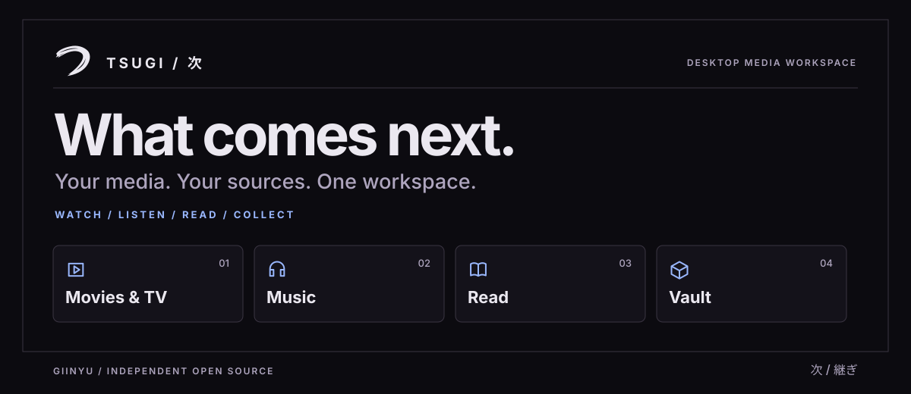
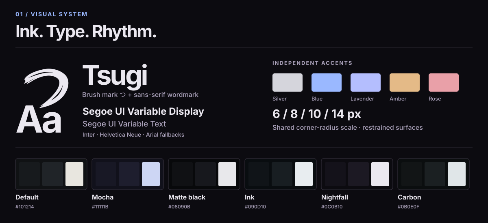
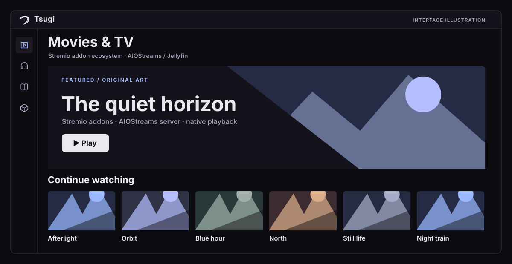
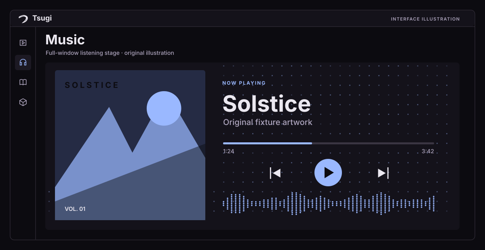
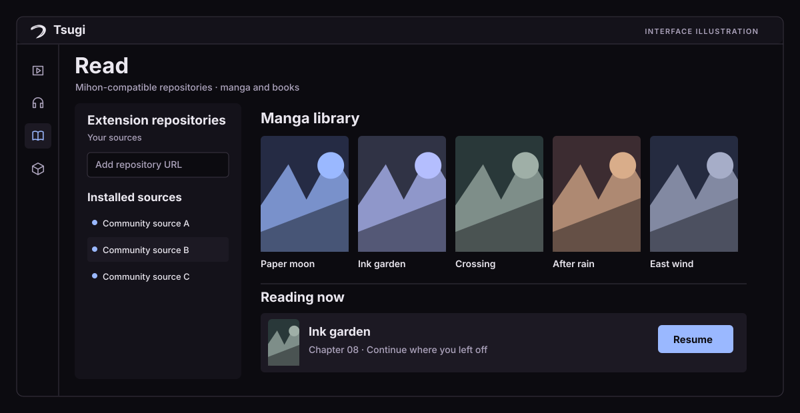
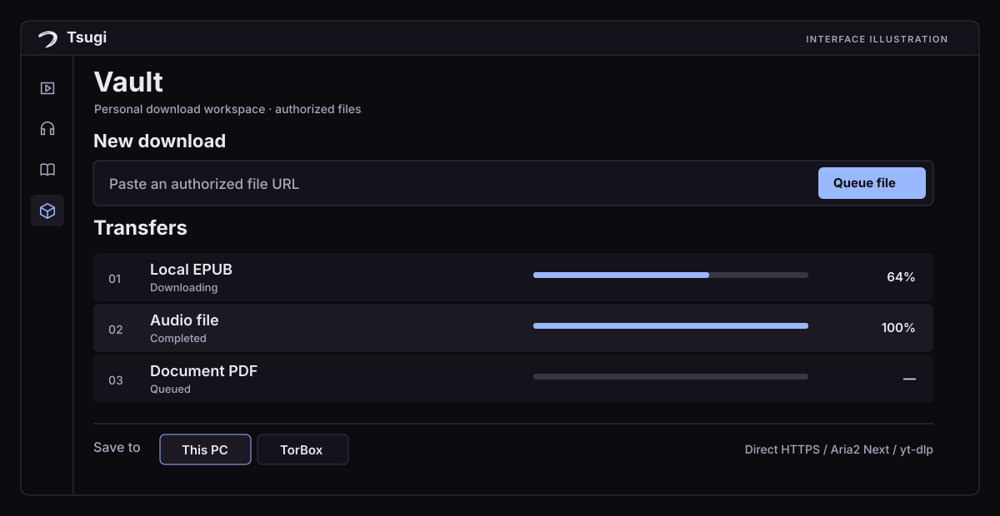

<p align="center"></p>

<p align="center">
  <a href="https://github.com/G1NYU/TSUGI/releases"><strong>Download Windows x64</strong></a> &nbsp;·&nbsp;
  <a href="https://github.com/G1NYU/TSUGI/tree/feature/tsugi-read-runtime">Source</a> &nbsp;·&nbsp;
  <a href="https://github.com/G1NYU/TSUGI/issues">Issues</a> &nbsp;·&nbsp;
  <a href="LICENSE">AGPL-3.0</a>
</p>

<p align="center"><sub>INDEPENDENT OPEN SOURCE · WINDOWS x64 · BY GIINYU</sub></p>

## 次 / 継ぎ — what comes next

**Tsugi** (つぎ) means *next* when written 次; 継ぎ, another spelling, evokes a join or continuation. The name joins two ideas: the next film, the next song, the next chapter — and a continuous experience across them.

Tsugi began with one purpose: **watching movies and television from the Stremio addon ecosystem through AIOStreams, with native desktop playback.** Music, manga, books and downloads extend that foundation rather than replace it.

Four independent media engines. One visual identity. Your own sources.

## Identity / design language



The original brush-stroke **つ** mark references the first sound of Tsugi, contrasted with a confident, tightly tracked sans-serif wordmark. The desktop uses **Segoe UI Variable Display** for headlines and **Segoe UI Variable Text** for interface copy, with Segoe UI, Inter, Helvetica Neue and Arial fallbacks. These are system typography choices, not a separately distributed custom font.

Three complementary design influences describe the direction:

- **Japanese minimalism and ma (間):** purposeful intervals, restraint, asymmetric balance and an organic ink gesture. Space gives the media room to breathe.
- **[Swiss / International Typographic Style](https://www.nb.admin.ch/en/the-international-style-1950-1970):** structured grids, strong sans-serif hierarchy, aligned information and disciplined composition.
- **Functional modernism / Bauhaus-inspired reduction:** geometry follows the control's purpose; unnecessary ornament is removed rather than added.

The result is a media-led interface: wide cinematic heroes, full-window listening stages, a compact shared rail, consistent outline iconography and restrained 6 / 8 / 10 / 14 px corner radii. Alternating tonal surfaces separate rows; the workspace canvas stays continuous instead of enclosing every region in a contrasting box.

| Palette | Canvas | Surface | Panel | Text |
| :--- | :--- | :--- | :--- | :--- |
| Default | `#101214` | `#171A1D` | `#202428` | `#E8E6DF` |
| Mocha | `#11111B` | `#181825` | `#1E1E2E` | `#CDD6F4` |
| Matte black | `#08090B` | `#101114` | `#17181D` | `#E8E8EB` |
| Ink | `#090D10` | `#101418` | `#181E22` | `#E8EDF0` |
| Nightfall | `#0C0B10` | `#14121A` | `#1C1923` | `#EBE8F0` |
| Carbon | `#0B0E0F` | `#121516` | `#1B2022` | `#E0E6E8` |

Independent accents: Silver `#D5D5DC` · Blue `#9AB8FF` · Lavender `#B4BEFE` · Amber `#E4BA87` · Rose `#E9A0A8`. Mocha uses the [Catppuccin](https://github.com/catppuccin/catppuccin) palette.

The original SVG artwork throughout this README is a deliberate project signature: scalable editorial illustrations based on the interface and actual palette tokens, not live screenshots or bundled media covers.

## Movies & TV / the foundation



Tsugi is an independent fork of [AIOStreams](https://github.com/Viren070/AIOStreams). Its primary video workflow brings **Stremio addons to a native desktop viewing experience** using AIOStreams' configured media server.

```text
Stremio-compatible addons (catalogue, metadata, streams, subtitles)
                         |
                  AIOStreams configuration
             aggregation / sorting / filtering / formatting
                         |
                Jellyfin-compatible media API
                         |
                       Tsugi
                 native mpv playback
```

AIOStreams aggregates the addons you configure and exposes a media-server endpoint speaking the Jellyfin API, with [AIOStreams-specific extensions](https://aiostreams.org/reference/jellyfin-extensions/). Tsugi connects to that endpoint; it does not require installing a separate Jellyfin server, nor does it directly install Stremio addons into the desktop client. An existing compatible Jellyfin server can also be connected.

- Browse home, discovery, libraries, search, favourites and media detail pages.
- Server-provided stream versions, native mpv playback, subtitles, audio tracks, continue watching and history.
- Preserve the server's addon sorting, stream filtering and formatting. Live TV and playlists depend on server support.
- Configure your own instance, metadata providers and authorized services in AIOStreams.

Start with the [AIOStreams setup guide](https://aiostreams.org/configuration/setup/), [Jellyfin client documentation](https://aiostreams.org/apps/jellyfin/) and [Stremio addon protocol](https://aiostreams.org/reference/addon-protocol/).

## Extensions, addons and APIs

The common principle is **bring your own sources**, not one universal plugin format. Video uses server-side Stremio addons, Music accepts Eclipse manifests, Read accepts Mihon-compatible repositories, and Vault uses explicit transfer jobs. Local files work without a remote catalogue.

| Integration | Role in Tsugi |
| :--- | :--- |
| [Stremio addon SDK](https://github.com/Stremio/stremio-addon-sdk) / [AIOStreams](https://aiostreams.org/) | Server-side catalogue, metadata, stream and subtitle aggregation |
| [Jellyfin API](https://api.jellyfin.org/) | Video server connection, browsing, playback information and watch state |
| [Eclipse Music](https://eclipsemusic.app/) | Addon manifests, search, catalogue, streams and optional community registry |
| YouTube Music / [yt-dlp](https://github.com/yt-dlp/yt-dlp) / [Deno](https://github.com/denoland/deno) | Native music provider and audio transport; not an official public YouTube Music API |
| [LRCLIB](https://lrclib.net/) | Optional synchronized and plain lyric lookup |
| [Suwayomi GraphQL](https://github.com/Suwayomi/Suwayomi-Server) | Managed reading runtime, repository installation, source search and chapter access |
| [MyAnimeList](https://myanimelist.net/apiconfig/references/api/v2) / [AniList](https://docs.anilist.co/) | Initial tracker authorization and explicit progress sync; live sync still requires acceptance |
| [Kitsu](https://kitsu.io/) / [Nekos API](https://nekosapi.com/) | Optional reader and Vault atmospheric artwork; local-only preference available |
| [Aria2 Next](https://github.com/AnInsomniacy/aria2-next) JSON-RPC / [TorBox API](https://api.torbox.app/) | Managed local transfers and optional cloud download submissions |

## Music / a dedicated listening space



- Native Windows YouTube Music and Eclipse-compatible addons; discovery, track, album, artist and playlist search.
- Local audio library, remembered folders, saved tracks, playlists, shuffle, repeat and editable queue.
- Default, Junction and Nocturne full-window player layouts; imported Eclipse Studio layouts remain supported.
- Context-sized artwork with same-image fallback, replay reuse and deterministic next-track prefetch.
- Immersive, Minimal, Dot Wave and Off visualizers; local Web Audio PCM and measured native mpv level telemetry. Native RMS is a level envelope, not reconstructed PCM. Supported local/native audio profiles and EQ; other remote addon streams remain unmodified.
- Continue listening while browsing manga or reading. Video playback remains exclusive to avoid competing audio.

Cold first-track startup still waits on the existing native transfer; subsequent tracks can benefit from prefetch. Native filters passed generated-fixture validation on Windows; physical latency, real-source artwork and visualization performance remain acceptance items.

## Read / Mihon-compatible repositories on Windows



A particularly uncommon desktop capability is **direct in-app support for Mihon-compatible extension repository URLs**. Tsugi manages a pinned Suwayomi runtime and Java environment behind its own interface. A first-run setup fetches and verifies the runtime: no separate Java installation, external Suwayomi launcher or manually maintained scraper list is required.

Add a trusted repository, install individual extensions, browse their catalogues, search across sources and read chapters. The workflow is familiar to users of [Mihon](https://github.com/mihonapp/mihon) and [Komikku](https://github.com/komikku-app/komikku).

Related desktop projects sharing this ecosystem include [Suwayomi](https://github.com/Suwayomi/Suwayomi-Server), [Moku](https://github.com/moku-project/Moku), [Kagami](https://github.com/ItsMeYoshiro/kagami-manga-reader-desktop) and [Mirah](https://github.com/MirahApp/Mirah). They approach compatible extension execution differently. Tsugi combines that repository workflow with Stremio-based video, music and downloads in a single desktop shell. Community stores such as [Keiyoushi](https://github.com/keiyoushi/extensions) may be added by the user; compatibility is per extension, not universal.

- Manga and manhwa library, installed sources, global search and extension catalogue.
- Continuous vertical, single-page and two-page reading, zoom, direction, page spacing and focus mode.
- Chapter progress, bookmarks, resume reading and initial MAL/AniList integration.
- EPUB and PDF offline collection, pagination or continuous scrolling, text size, paper themes, contents and resume position. Pinned Readest/Foliate and PDF.js render in an isolated origin with book scripts disabled.

Repositories and extensions are not bundled. Third-party extensions are executable code; only install from trusted publishers. Extension signatures are not independently verified.

## Vault / collect and return to your library



Persistent authorized HTTPS downloads with progress, retry, pause and cancellation; managed Aria2 Next concurrent direct transfers. Individual authorized YouTube Music M4A exports use bundled yt-dlp. TorBox provides explicit cloud submissions and a session-only API key.

Import completed books into Read or open downloaded audio in Music. Files remain in the native download folder. Direct Z-Library account integration is not included.

## Get Tsugi

**Windows x64:** visit [GitHub Releases](https://github.com/G1NYU/TSUGI/releases) and choose the latest published version. Each release includes a portable ZIP, a SHA-256 checksum, validation links and matching source references.

1. Download `Tsugi-windows-x64.zip` from the release assets.
2. Extract the entire ZIP into a writable folder, including its `.portable` marker.
3. Run `current/Tsugi.exe`, keeping companion files alongside it.
4. Choose a palette and accent, then enter your AIOStreams/Jellyfin server address. The other spaces can be configured independently.

This is a portable application, not an installer. Windows may warn about the unsigned executable. Back up portable application data before replacing files. [Development builds](https://github.com/G1NYU/TSUGI/actions/workflows/tsugi-unified-windows.yml) are available separately; their artifacts expire.


## Architecture / development

| Layer | Foundation |
| :--- | :--- |
| Desktop | Rust, Windows WebView2 |
| Interface | React, TypeScript, shared CSS design tokens |
| Video | AIOStreams, Jellyfin API, mpv |
| Music | Eclipse providers, yt-dlp, Deno, mpv, Web Audio |
| Read | Suwayomi, Java, Readest/Foliate, PDF.js |
| Vault | Rust queue, Aria2 Next, yt-dlp, TorBox WebDL |
| Validation | Vitest, Playwright, Cargo, GitHub Actions |

The unified app lives on [`feature/tsugi-read-runtime`](https://github.com/G1NYU/TSUGI/tree/feature/tsugi-read-runtime); main remains the upstream baseline with public documentation.

```sh
git clone --branch feature/tsugi-read-runtime https://github.com/G1NYU/TSUGI.git
cd TSUGI
corepack enable
pnpm install --frozen-lockfile
pnpm -F @aiostreams/core build
pnpm -F @aiostreams/web typecheck
pnpm -F @aiostreams/web lint
pnpm -F @aiostreams/web prepare:ebooks
```

Node.js 24+, pnpm 11+ and Rust are required. See the [Windows packaging workflow](https://github.com/G1NYU/TSUGI/blob/feature/tsugi-read-runtime/.github/workflows/tsugi-unified-windows.yml), [reading runtime notes](https://github.com/G1NYU/TSUGI/blob/feature/tsugi-read-runtime/docs/tsugi-read-runtime.md), [roadmap](https://github.com/G1NYU/TSUGI/blob/feature/tsugi-read-runtime/ROADMAP.md) and [development history](https://github.com/G1NYU/TSUGI/blob/feature/tsugi-read-runtime/PROGRESS.md). Latest web, native and packaging checks passed. Live source compatibility, tracker authorization, provider transfers and physical performance remain acceptance items. Refract and MangaBaka are not shipped.

## Support and bug reports

Found a cicada? Use **App settings → Report bugs** or [browse Tsugi issues](https://github.com/G1NYU/TSUGI/issues). The in-app Diagnostics section creates a reviewable, allowlisted build summary without uploading logs or account details. See the [reporting guide](docs/support.md). About Tsugi includes matching source references, credits, dependency licenses and third-party notices.

## Credits & license

Maintained by [giinyu](https://github.com/G1NYU) as an independent fork of [Viren070/AIOStreams](https://github.com/Viren070/AIOStreams). Not an official AIOStreams, Stremio, Jellyfin, Suwayomi, Mihon, Eclipse or YouTube application.

With credit to [AIOStreams](https://github.com/Viren070/AIOStreams), [Stremio](https://github.com/Stremio), [Jellyfin](https://jellyfin.org/), [mpv](https://mpv.io/), [FFmpeg](https://ffmpeg.org/), [libass](https://github.com/libass/libass), [yt-dlp](https://github.com/yt-dlp/yt-dlp), [Deno](https://github.com/denoland/deno), the Eclipse community, [Suwayomi](https://github.com/Suwayomi/Suwayomi-Server), [Mihon](https://github.com/mihonapp/mihon), [Seanime](https://github.com/5rahim/seanime), [Readest](https://github.com/readest/readest), [Readest/Foliate](https://github.com/readest/foliate-js), [PDF.js](https://github.com/mozilla/pdf.js), [Aria2 Next](https://github.com/AnInsomniacy/aria2-next) and the API and extension developers named above.

### GNU Affero General Public License v3.0

Tsugi's source is licensed under the **[GNU AGPL-3.0](LICENSE)**, inherited from AIOStreams. It is the Affero variant of GPLv3, not a permissive license or plain GPLv3. You may run, study, modify and redistribute the covered program under its terms. When conveying covered modifications or binaries, retain notices, license the covered work as required and make the complete Corresponding Source available in a permitted manner. Section 13 also requires a modified version that supports remote network interaction to prominently offer its Corresponding Source to users interacting with it remotely. See the [complete license text](https://www.gnu.org/licenses/agpl-3.0.html) for the precise conditions and definitions.

Source for the distributed Tsugi application and build scripts is available at the [matching tag and source references in each release](https://github.com/G1NYU/TSUGI/releases). Separately distributed or incorporated components retain their own licenses and notices: the patched libmpv/FFmpeg playback build is GPL-3.0, Aria2 Next is a separate GPLv2 sidecar with accompanying source, and standalone FFmpeg tools have their own LGPL configuration. Other components are covered by their respective licenses. See [third-party notices and corresponding source references](https://github.com/G1NYU/TSUGI/blob/feature/tsugi-read-runtime/packages/desktop/THIRD-PARTY.md), packaged license files and source archives.

The program is provided without warranty, as set out in the license. Tsugi does not host or supply copyrighted media, subscriptions or bundled content sources. Use only sources you are authorized to access and comply with applicable terms and law.

---

<p align="center"><strong>Tsugi / 次</strong><br><sub>WATCH · LISTEN · READ · COLLECT &nbsp; / &nbsp; GIINYU</sub></p>
